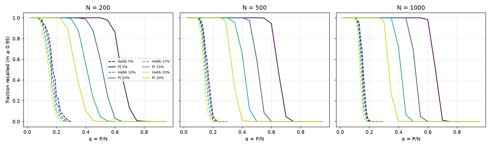
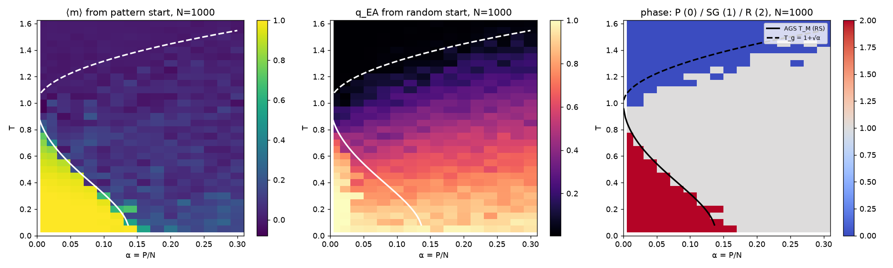

# How much can a Hopfield network remember?

*Research question: Oriphim held-out test set. Computation, analysis and drafting: Ori (Oriphim), with an independent review.*

## Abstract

We simulated Hopfield memories of 200 to 1000 neurons.

- **Hebbian rule.** The load (patterns per neuron) at which half of the noisy cues are recalled falls as the network grows. At 1000 neurons it is {{results/summary.json:capacities.8.alpha_c|.3f}} to {{results/summary.json:capacities.11.alpha_c|.3f}}, depending on how noisy the cue is. These values sit either side of the theoretical storage capacity, {{results/summary.json:theory.alpha_c_RS_T0|.3f}}, but what we measured is a recall capacity, not that quantity.
- **Pseudo-inverse rule.** Recall holds up to a load of {{results/summary.json:capacities.47.alpha_c|.2f}}–{{results/summary.json:capacities.44.alpha_c|.2f}} (20 % to 5 % flipped bits), nearly the same at N = 200–1000.
- **Phase diagram.** The temperature–load phase diagram matches theory to within 0.25 in temperature.
- **False memories.** When only a few patterns (up to 7) are stored, about a quarter of random starts end in a spurious mixture of patterns.

## 1. Question

A Hopfield network stores memories as stable states of ±1 neurons that align with their local field, so a damaged memory relaxes back to the original. It is the textbook model of content-addressable memory. We ask four questions:

- how much it can store;
- how temperature changes that;
- which false memories it makes;
- how much the pseudo-inverse rule helps.

Mean-field theory by Amit, Gutfreund and Sompolinsky (AGS) answers these for an infinitely large network. We test it at finite size N.

## 2. Method

- **Patterns.** Random, unbiased ±1 patterns.
- **Couplings.** Two rules: Hebbian (outer products divided by N), and pseudo-inverse, a projection onto the patterns. Self-couplings are zero in both.
- **Dynamics.** At T = 0, asynchronous sign updates in random order until the state is stable. At T > 0, Glauber dynamics.
- **Recall.** Cues are patterns with 5–20 % of their bits flipped, at least 400 per point. The capacity α_c is the load at which half of the cues end with overlap m ≥ 0.95.
- **Phase labels.** Retrieval if m ≥ 0.5 from a pattern start. Otherwise spin glass if the freezing parameter q ≥ 0.1 from a random start. Otherwise paramagnet.

## 3. Results

| flipped bits | Hebb N=200 | Hebb N=1000 | pseudo-inverse N=1000 |
|---|---|---|---|
| 5 % | {{results/summary.json:capacities.0.alpha_c|.3f}} | {{results/summary.json:capacities.8.alpha_c|.3f}} | {{results/summary.json:capacities.44.alpha_c|.3f}} |
| 20 % | {{results/summary.json:capacities.3.alpha_c|.3f}} | {{results/summary.json:capacities.11.alpha_c|.3f}} | {{results/summary.json:capacities.47.alpha_c|.3f}} |

**Capacity.**
- **Hebbian.** α_c falls with N and depends on cue noise, because it reflects basin size as well as whether retrieval states exist. At N = 1000 it brackets the AGS value ({{results/summary.json:capacities.8.alpha_c|.3f}} at 5 % to {{results/summary.json:capacities.11.alpha_c|.3f}} at 20 % flipped bits). Whether it tends to 0.138 as N → ∞ and noise → 0 was not tested. Exact recall gives {{results/summary.json:capacities.32.alpha_c|.3f}} (N = 1000, the same at every cue noise).
- **Pseudo-inverse.** In theory every pattern stays stable up to α → 1. Here recall is limited by shrinking basins, and α_c hardly depends on N.
- All rows are in `results/capacities.csv`.

**Phase diagram.**
- **Retrieval edge.** It follows AGS: at α = 0.01 it is at T = {{results/summary.json:phase_boundaries.0.T_R_max_sim|.2f}} (theory {{results/summary.json:phase_boundaries.0.T_M_theory|.2f}}); at α = 0.12 it is at {{results/summary.json:phase_boundaries.6.T_R_max_sim|.2f}} (theory {{results/summary.json:phase_boundaries.6.T_M_theory|.2f}}).
- **Retrieval labels at α = 0.14–0.16.** These are finite-size, finite-time states, not retrieval beyond AGS.
- **Spin-glass edge.** It sits up to about 0.2 below 1 + √α, as the q cut-off implies.

**Spurious states.**
- **Symmetric 3-mixtures** capture a share of random starts that falls with the number of patterns P: {{results/summary.json:spurious_basins.0.frac_mix3|.2f}}, {{results/summary.json:spurious_basins.1.frac_mix3|.2f}}, {{results/summary.json:spurious_basins.2.frac_mix3|.2f}}, {{results/summary.json:spurious_basins.3.frac_mix3|.2f}} and {{results/summary.json:spurious_basins.4.frac_mix3|.3f}} at P = 3, 5, 7, 10 and 20. Higher mixtures add a few percent.
- **At P = 50**, a fraction {{results/summary.json:spurious_basins.5.frac_other|.2f}} of starts end in "other" states.
- **Stability.** 3-mixtures are exact fixed points in {{results/summary.json:mixture_stability.5.frac_exact_fixed|.0%}} of trials at P = 20 and {{results/summary.json:mixture_stability.8.frac_exact_fixed|.0%}} at P = 50.

## 4. How it was checked

- **Checks set in advance.** Before the main run, an independent reviewer (the Sceptic) fixed 34 pass/fail checks in `tests/checks/`. They cover integrity, convergence ({{results/summary.json:hebb_nonconverged_runs}} unconverged runs), the theory solver, capacity windows, phase boundaries within 0.25 in T, and spurious states.
- **Outcome.** All 34 checks and 9 unit tests pass, and runs are reproducible bit for bit on this machine with 1 or 8 workers.
- **After the run.** The review found no suspect results, so nothing was rerun. Its five interpretation points became the limits below.
- **This draft.** Its reviews made the claims more cautious:
  - the Hebbian capacity "brackets" the AGS value, and its large-N limit is stated as untested;
  - mixture fractions are given for each P;
  - the spin-glass offset is "up to about 0.2";
  - the retrieval labels beyond the AGS line are explained;
  - pseudo-inverse stability up to α → 1 is attributed to theory.

  The reviews also caught a Results section that an editing script had dropped, and it was restored.

## 5. What this does not show (from LIMITS.md)

- **Scope.** Only unbiased, uncorrelated patterns, zero self-coupling and asynchronous updates were tested.
- **Hebbian α_c.** It is not the AGS storage capacity. The zero-noise, infinite-N limit was not measured, and a 3-point size fit cannot settle 0.138 to better than ±0.01. The bootstrap intervals in `results/capacities.csv` are about 1.5 times too narrow.
- **Pseudo-inverse α_c.** Above α = 0.30 it is interpolated over steps of 0.05, and it was tested only up to N = 1000.
- **Phase diagram.** It rests on one N, 2 pattern sets and 300 sweeps, with no equilibration check. "Retrieval" means metastable. The labels depend on the chosen thresholds. A spin glass is not separated from trapping in mixtures, and replica-symmetry-breaking corrections are not resolved.
- **Spurious states.** At small P, "other" states are mostly asymmetric mixtures, not a spin glass. Counts of distinct states are lower bounds.

## 6. Reproducing it

`python run.py && python -m pytest -q tests` (numpy, scipy, matplotlib, numba). It uses seed {{results/summary.json:seed}} and takes about {{results/summary.json:wall_time_s|.0f}} s. The code is in `src/hopfield/` and the plan in `PLAN.md`.

**References.** Hopfield, PNAS 79, 2554 (1982). Amit, Gutfreund & Sompolinsky, PRA 32, 1007 (1985); Ann. Phys. 173, 30 (1987). Personnaz et al., J. Phys. Lett. 46, L359 (1985). Kanter & Sompolinsky, PRA 35, 380 (1987).
